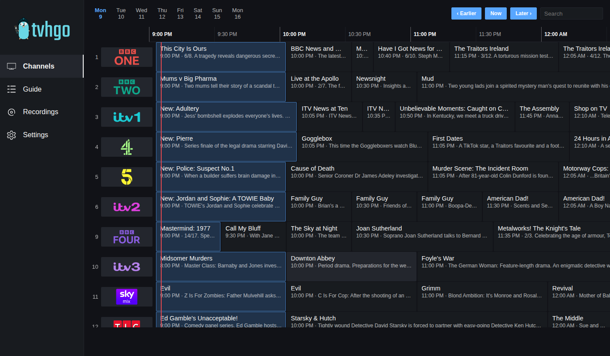
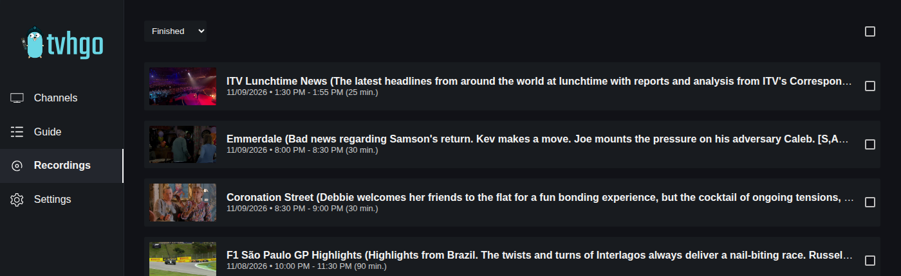
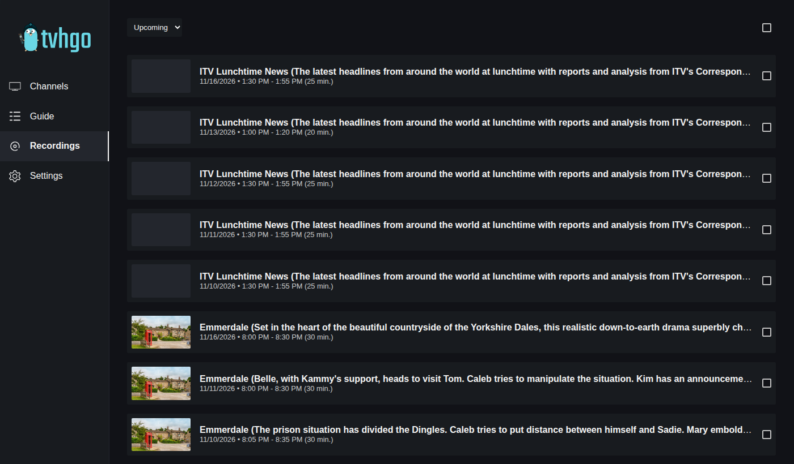
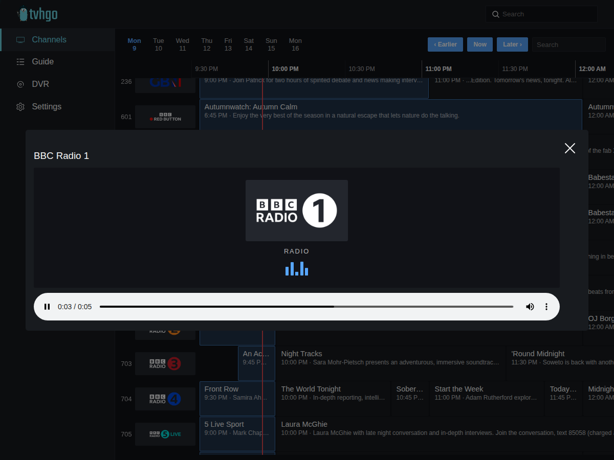
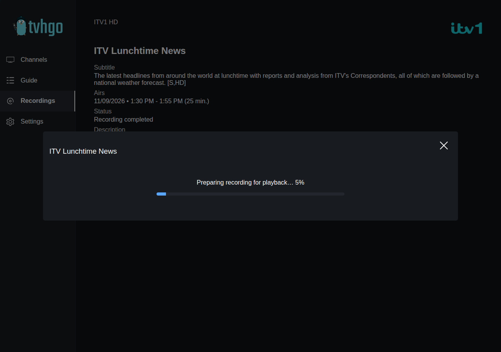

<p align="center">

</p>

<h3 align="center">tvhgo with an in-browser player</h3>

<p align="center">
  <a href="#what-this-fork-adds">What this fork adds</a> |
  <a href="#installation">Installation</a> |
  <a href="#screenshots">Screenshots</a> |
  <a href="#credits">Credits</a>
</p>

> **This is a fork** of [tvhgo](https://github.com/davidborzek/tvhgo) by [David Borzek](https://github.com/davidborzek)
> (MIT) - a modern, secure web interface and API for [Tvheadend](https://tvheadend.org). All the original features
> remain; this fork adds watching live TV and playing recordings in the browser. Full credit for tvhgo itself goes to
> the original author and contributors - see [Credits](#credits). If you do not need the player, please use the
> [original project](https://github.com/davidborzek/tvhgo).
>
> **AI disclosure:** the additions in this fork were developed with **Claude** (Anthropic's AI model, used through
> Claude Code). See [AI assistance](#ai-assistance) below.



## Features

### From the original tvhgo

- Channel list and TV guide
- Create and manage recordings
- Two-factor authentication, sessions and API tokens
- Multiple languages (English/German)
- Prometheus metrics

### What this fork adds

- **Watch live TV in the browser.** Click a programme or a channel logo. Pick **1080p / 720p / 480p / 360p**
  (tvhgo transcodes Tvheadend's raw stream with ffmpeg, so it works with any Tvheadend, no profile setup needed) or
  **Auto**, which uses Tvheadend's own browser profile. Your choice is remembered. Closing the player releases the
  tuner straight away.
- **Radio channels** play in the same player: audio-only streams are detected and shown with the station logo and an
  audio bar (no black video box).
- **Play finished recordings in the browser, with seeking.** tvhgo serves a browser-friendly MP4:
  1. a ready-made MP4 from a folder you point it at (for example from your own pipeline or a media server), else
  2. its own cache, else
  3. it **converts the recording on demand** with ffmpeg the first time you press Play (progress is shown; the next
     play is instant). The cache is size- and age-limited.
- **Timeline programme guide** on the Channels page: channels as rows, time left to right, a "now" line, day tabs
  (8 days), Earlier / Now / Later buttons and channel search. Click the programme on now or a channel logo to watch
  live; click any other programme to open it and record it.
- **Thumbnails for recordings.** A frame from the recording itself (a pipeline's `<name>-thumb.jpg` if there is
  one, otherwise extracted and cached), with optional **TMDb artwork** as the fallback - e.g. for upcoming
  recordings. Only exact title matches are used.
- **Recordings page** opens on *Finished*; the *Removed* filter is gone from the dropdown.
- Fixes: closing the browser now ends the Tvheadend stream (the original kept it open and held a tuner), and the
  guide includes programmes that began before the visible window.
- Everything is configurable with environment variables or the config file; conversion and TMDb are off unless you
  enable them. See [docs/player.md](docs/player.md).

## Installation

Docker is the supported way. The image for this fork is **built from source** (there is no published image yet):

```bash
git clone https://github.com/davewins/tvhgo-player.git tvhgo && cd tvhgo
cp .env.example .env                         # set your Tvheadend host, user and password
mkdir -p data && sudo chown 1000:1000 data
docker compose -f docker-compose.example.yml up -d --build
docker compose -f docker-compose.example.yml exec tvhgo tvhgo admin user add
```

Then open <http://localhost:8080>. Before you start you need a limited Tvheadend user for tvhgo and to mount your
recordings folder - the full step-by-step guide is in **[docs/installation/docker.md](docs/installation/docker.md)**, including
reverse-proxy notes and troubleshooting.

- [Installation guide](docs/installation/docker.md)
- [Player, live TV, guide and thumbnails](docs/player.md)
- [All configuration options](docs/configuration.md) (including how to [set up TMDb artwork](docs/configuration.md#tmdb-artwork))
- [Example compose file](docker-compose.example.yml) and [`.env.example`](.env.example)

## Screenshots


*Timeline guide - click the current programme or a logo to watch live, any other programme to record it.*


*Finished recordings with thumbnails taken from the recordings.*


*Upcoming recordings with TMDb artwork where the programme is found.*


*Radio channels play as audio only, with the station logo.*


*A recording with no MP4 yet is converted when you press Play.*

The original tvhgo screenshots are in [docs/screenshots](docs/screenshots/).

## AI assistance

Everything this fork adds (listed under [What this fork adds](#what-this-fork-adds)) was **developed together with
Claude**, an AI model from [Anthropic](https://www.anthropic.com), working through Claude Code:

- **[davewins](https://github.com/davewins)** came up with the idea, set the requirements, directed the design and
  decided what to keep, and ran and tested each feature on a real Tvheadend system.
- **Claude** wrote most of the code, the automated tests and the documentation under that direction.
- Commits that Claude wrote carry a `Co-Authored-By: Claude` trailer (GitHub shows Claude as a co-author).
- The original tvhgo code is the work of David Borzek and its contributors and was **not** AI-generated.

The new code has automated tests (Go and UI) and was tested in a real browser (Google Chrome), but it **has not yet had
an independent review by other people**. Please read it critically before relying on it, and report problems in the
[issues](https://github.com/davewins/tvhgo-player/issues).

## Credits

- **[tvhgo](https://github.com/davidborzek/tvhgo) by David Borzek and contributors** (MIT) - the project this is a
  fork of. All of the original application is their work.
- **[Tvheadend](https://tvheadend.org)** - the TV server and recorder that provides all channels, guide data,
  recording and streaming.
- **[The Movie Database (TMDb)](https://www.themoviedb.org)** - optional programme artwork.
  *This product uses the TMDB API but is not endorsed or certified by TMDB.*
- **[Claude](https://www.anthropic.com/claude) (Anthropic)** - AI pair programmer for the fork's additions, see
  [AI assistance](#ai-assistance).
- **[FFmpeg](https://ffmpeg.org)** and **[x264](https://www.videolan.org/developers/x264.html)** - conversion and
  live transcoding.

More detail, including licences, in [CREDITS.md](CREDITS.md).

## Licence

MIT, as the original: see [LICENSE](LICENSE). The original copyright notice is retained.

## Contributing

Contributing and pull requests are very welcome.

More information about contributing to this project can be found [here](CONTRIBUTING.md)
